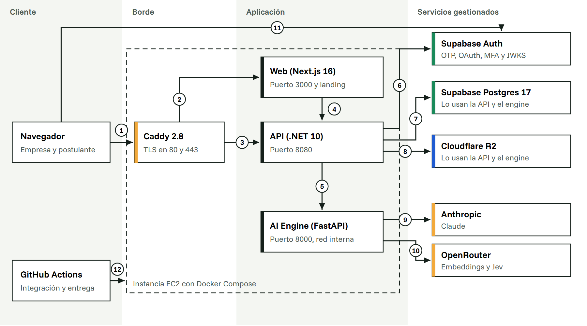
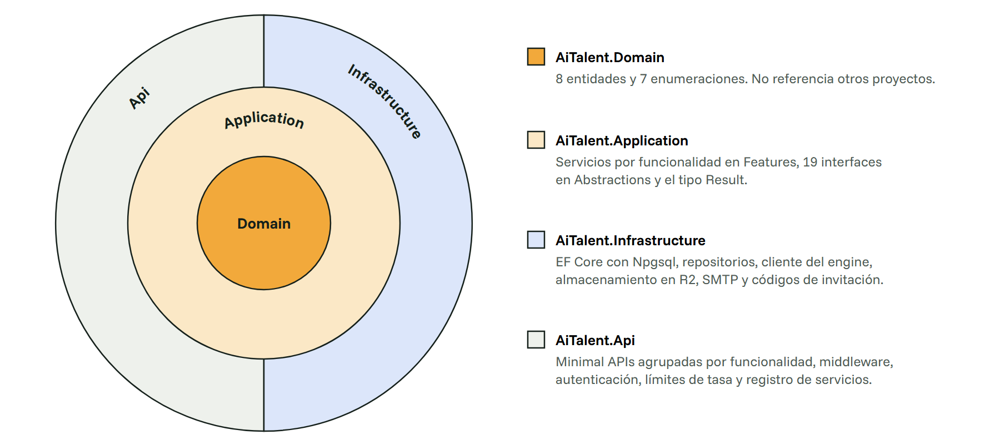
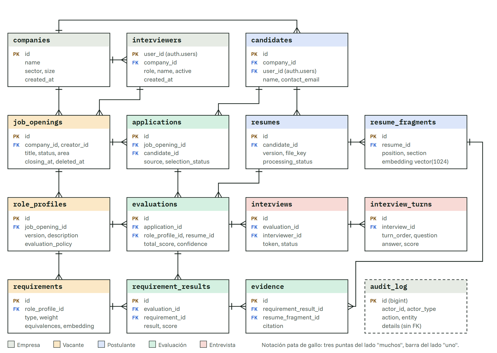
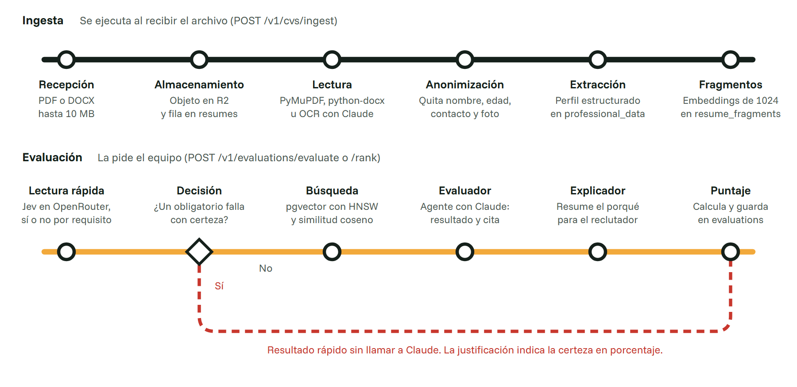
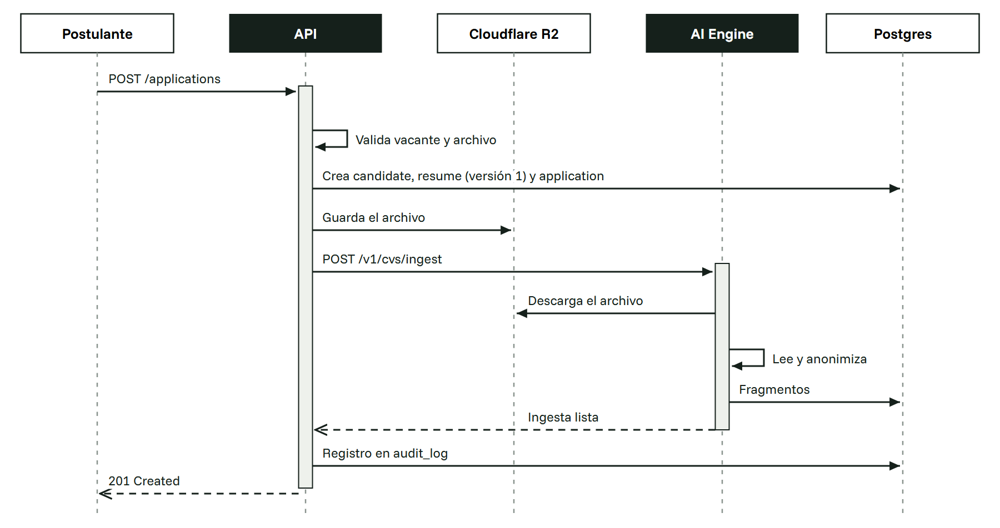
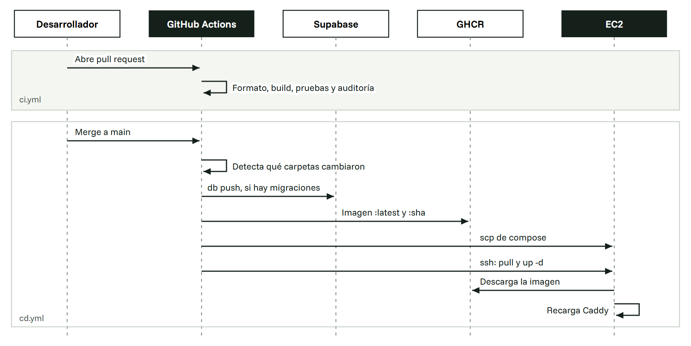

# Manual técnico de Criba

AI Talent Scout. Arquitectura, modelo de datos, contratos de la API, seguridad, despliegue y operación de la plataforma.

| | |
| --- | --- |
| Versión del documento | 1.0 |
| Fecha | 13 de noviembre de 2026 |
| Commits de referencia | Backend `407a437`, web `1aa0059` |
| Clasificación | Uso interno del equipo |
| Versión en PDF | [Criba-Manual-Tecnico-v1.0.pdf](./Criba-Manual-Tecnico-v1.0.pdf) |

## Control del documento

|  |  |
| --- | --- |
| Producto | Criba (AI Talent Scout), plataforma que ordena hojas de vida contra un perfil de cargo y justifica cada puntaje con citas del documento. |
| Organización | LaboratorioHack, repositorios privados en GitHub |
| Repositorio del backend | `LaboratorioHack/ai_talent_back`, rama `feat/criba-assistant`, commit `407a437` (87 commits) |
| Repositorio del frontend | `LaboratorioHack/ai_talent_web`, rama `feat/criba-assistant`, commit `1aa0059` (290 commits). Incluye la landing en `landing/`. |
| Versión de los componentes | Web 0.1.0, landing 0.1.0, AI Engine 0.1.0. La API .NET apunta a `net10.0` y no declara versión de ensamblado. |
| Versión del esquema | Migración `20261113140000_application_submitted_by`, octava aplicada |
| Entornos | Producción en `app.criba.isroot.in` (aplicación y API) y `criba.isroot.in` (landing). Desarrollo local. |
| Público | Desarrolladores, operadores y evaluadores técnicos |
| Origen de la información | Código de los dos repositorios y consulta directa al catálogo de la base de datos de desarrollo (PostgreSQL 17.11) el 13 de noviembre de 2026 |

### Historial de cambios

| Versión | Fecha | Descripción |
| --- | --- | --- |
| 1.0 | 13/11/2026 | Primera edición. |

## Contenido

- [1. Visión general del sistema](#1-visión-general-del-sistema)
  - [1.1 Actores](#11-actores)
  - [1.2 Módulos funcionales](#12-módulos-funcionales)
- [2. Tecnologías y versiones](#2-tecnologías-y-versiones)
  - [2.1 Frontend](#21-frontend)
  - [2.2 API](#22-api)
  - [2.3 AI Engine](#23-ai-engine)
  - [2.4 Servicios externos](#24-servicios-externos)
- [3. Arquitectura](#3-arquitectura)
  - [3.1 Vista de despliegue](#31-vista-de-despliegue)
  - [3.2 Capas de la API](#32-capas-de-la-api)
  - [3.3 Patrones de diseño](#33-patrones-de-diseño)
- [4. Organización del código](#4-organización-del-código)
  - [4.1 Repositorio del backend](#41-repositorio-del-backend)
  - [4.2 Repositorio del frontend](#42-repositorio-del-frontend)
  - [4.3 Rutas de la aplicación web](#43-rutas-de-la-aplicación-web)
- [5. Modelo de datos](#5-modelo-de-datos)
  - [5.1 Diagrama entidad relación](#51-diagrama-entidad-relación)
  - [5.2 Diccionario de datos](#52-diccionario-de-datos)
  - [5.3 Seguridad en la base de datos y migraciones](#53-seguridad-en-la-base-de-datos-y-migraciones)
- [6. Procesamiento con IA y cálculo del puntaje](#6-procesamiento-con-ia-y-cálculo-del-puntaje)
  - [6.1 Cálculo del puntaje](#61-cálculo-del-puntaje)
  - [6.2 Agentes](#62-agentes)
  - [6.3 Uso responsable de la IA](#63-uso-responsable-de-la-ia)
- [7. API](#7-api)
  - [7.1 Rutas de la API .NET](#71-rutas-de-la-api-net)
  - [7.2 Rutas internas del AI Engine](#72-rutas-internas-del-ai-engine)
  - [7.3 Flujo de una postulación](#73-flujo-de-una-postulación)
  - [7.4 Estados](#74-estados)
- [8. Seguridad](#8-seguridad)
- [9. Configuración](#9-configuración)
  - [9.1 Ajustes manuales en Supabase](#91-ajustes-manuales-en-supabase)
- [10. Despliegue e integración continua](#10-despliegue-e-integración-continua)
  - [10.1 Pipelines](#101-pipelines)
  - [10.2 Imágenes](#102-imágenes)
  - [10.3 Secretos de GitHub](#103-secretos-de-github)
  - [10.4 Preparación del EC2](#104-preparación-del-ec2)
- [11. Desarrollo local y pruebas](#11-desarrollo-local-y-pruebas)
  - [11.1 Pruebas](#111-pruebas)
- [12. Operación y limitaciones](#12-operación-y-limitaciones)
  - [12.1 Procedimientos frecuentes](#121-procedimientos-frecuentes)
  - [12.2 Limitaciones conocidas](#122-limitaciones-conocidas)
  - [12.3 Trabajo pendiente](#123-trabajo-pendiente)
- [Anexo A. Capturas de la aplicación](#anexo-a-capturas-de-la-aplicación)

## 1. Visión general del sistema

Criba recibe hojas de vida en PDF, DOCX o imagen escaneada, les quita los datos personales y las evalúa contra los requisitos de una vacante. El resultado es un ranking en el que cada punto de cada candidato tiene una cita textual de su hoja de vida que lo respalda. El equipo de selección decide; la IA ordena y explica.

El sistema está compuesto por tres servicios propios (web, API y AI Engine) que corren en contenedores sobre un EC2, una base de datos PostgreSQL gestionada por Supabase y varios proveedores externos de IA y almacenamiento. La API expone 54 rutas HTTP, la base de datos tiene 15 tablas en el esquema `app` y el backend cuenta con 245 pruebas automatizadas.

### 1.1 Actores

| Actor | Autenticación | Funciones |
| --- | --- | --- |
| Administrador | Supabase Auth con MFA (TOTP) | Crea la empresa, genera códigos de invitación y administra al personal. Puede hacer todo lo que hace un reclutador. |
| Reclutador | Supabase Auth | Crea vacantes y perfiles de cargo, revisa postulaciones, lanza evaluaciones, consulta el ranking y la matriz e invita a entrevista. |
| Postulante | Ninguna para postularse. Enlace mágico u OAuth para el portal. | Consulta la vacante, se postula con su hoja de vida, responde la entrevista por chat y sigue sus postulaciones. |
| AI Engine | Clave compartida en la red interna | Ingesta, anonimización, extracción, evaluación, explicación, comparación y asistente. |

### 1.2 Módulos funcionales

| Módulo | Rutas de la web | Alcance |
| --- | --- | --- |
| Registro | `/login`, `/onboarding/1` a `/onboarding/3` | Creación de la empresa o ingreso con código de invitación. |
| Vacantes | `/vacancies`, `/vacancies/[id]/profile` | Ciclo de vida de la vacante y perfil de cargo con requisitos, pesos y equivalencias. La IA puede proponer los requisitos. |
| Postulaciones | `/candidates` | Tablero de la convocatoria, etapas de selección y estado de lectura de cada hoja de vida. |
| Ranking | `/rankings/[jobId]`, `/rankings/[jobId]/matriz` | Puntaje, cumplimiento, confianza y evidencia por requisito. Comparación entre candidatos. |
| Entrevistas | `/interviews`, `/interview/[token]` | Invitación por correo, entrevista por chat con preguntas sobre lo que la evaluación no pudo confirmar y resultado para el equipo. |
| Gobierno | `/governance` | Bitácora de auditoría con las acciones de las personas y de la IA. |
| Portal del postulante | `/jobs/[id]`, `/portal` | Vacante pública, postulación, hoja de vida, recomendaciones, exportación y eliminación de datos. |

## 2. Tecnologías y versiones

Las versiones se tomaron de `package.json`, los archivos `.csproj`, `global.json`, `pyproject.toml` y los Dockerfile de cada servicio. Donde el manifiesto define un mínimo y no una versión exacta, se indica el mínimo.

### 2.1 Frontend

| Componente | Versión | Uso en el proyecto |
| --- | --- | --- |
| Next.js con App Router y Turbopack | 16.4.6 | Renderizado en servidor, Server Components, `cacheComponents` y salida `standalone` |
| React y React DOM | 19.3.0 | Interfaz |
| Tailwind CSS | 4.3.3 | Estilos sobre los tokens de `src/styles/globals.css` |
| @supabase/ssr y supabase-js | 0.12.7 y 2.119.0 | Sesión en cookies, OTP y OAuth con Google y Microsoft |
| react-hook-form y zod | 7.91 y 4.6.7 | Formularios y validación |
| pdfjs-dist y pdf-lib | 4.10.38 y 1.17.1 | Visor de hojas de vida con la cita resaltada y generación de PDF |
| Astro | 7.4.11 | Landing estática servida en `/landing` |
| Node.js y pnpm | 22 (alpine) y 12.5.1 | Ejecución y gestión de paquetes |

### 2.2 API

| Componente | Versión | Uso en el proyecto |
| --- | --- | --- |
| .NET SDK | 10.0.100 | Minimal APIs. Las advertencias se tratan como errores y la auditoría de NuGet está activa. |
| Npgsql.EntityFrameworkCore.PostgreSQL | 10.0.3 | Acceso a datos con EF Core, sin migraciones propias |
| Pgvector.EntityFrameworkCore | 0.3.0 | Columnas de tipo `vector` |
| Microsoft.Agents.AI y su paquete de Anthropic | 1.28.0 | Microsoft Agent Framework |
| JwtBearer e IdentityModel | 10.0.15 y 8.15.0 | Validación de los JWT de Supabase |
| Microsoft.Extensions.Http.Resilience | 11.0.0 | Reintentos y tiempos límite hacia el AI Engine |
| AWSSDK.S3 | 4.1.0 | Cloudflare R2 por la API compatible con S3 |
| MailKit | 5.0.0 | Envío de correo por SMTP |
| Scalar.AspNetCore | 2.20.0 | Documentación OpenAPI, solo en desarrollo |
| xUnit, NetArchTest.Rules | 2.9.3 y 1.3.2 | Pruebas unitarias, de integración y de arquitectura |

### 2.3 AI Engine

| Componente | Versión mínima | Uso en el proyecto |
| --- | --- | --- |
| Python | 3.12 | Imagen `python:3.12-slim`, dependencias fijadas con `uv.lock` |
| FastAPI y uvicorn | 0.162.4 y 0.54.0 | API interna |
| agent-framework-core y agent-framework-anthropic | 1.25.0 y 1.0.0b261106 | Agentes evaluador, explicador, comparador y asistentes |
| anthropic | 1.17.0 | Claude para texto y para OCR de imágenes |
| openai | 1.60.0 | Cliente para OpenRouter (embeddings) |
| psycopg con pool y pgvector | 3.3.8 y 0.5.1 | Acceso a PostgreSQL y búsqueda vectorial |
| pymupdf y python-docx | 2.1 y 1.2.0 | Lectura de PDF y DOCX |
| boto3 y supabase | 1.35.0 y 2.34.1 | Descarga de archivos desde R2 o Supabase Storage |
| pytest y ruff | 9.2.0 y 0.17.4 | Pruebas y análisis estático |

### 2.4 Servicios externos

| Servicio | Detalle | Uso |
| --- | --- | --- |
| Supabase Postgres | PostgreSQL 17.11 en aarch64. Extensiones `vector` 0.8.2, `pgcrypto` 1.3, `uuid-ossp` 1.1, `pg_stat_statements` 1.11 y `supabase_vault` 0.3.1. | Base de datos |
| Supabase Auth | OTP por correo, OAuth y MFA. Tokens con vigencia de 3600 segundos. | Identidad |
| Anthropic | Modelo por defecto `claude-haiku-5-5`, configurable | Evaluación, explicación y OCR |
| OpenRouter | Embeddings con `nvidia/nemotron-3.5-embed-1b:free` y respaldo `mongodb/voyage-4-lite`. Lectura rápida con `typesafe/jev-1.14`. | Embeddings y descarte temprano |
| Cloudflare R2 | Bucket `cvs` | Archivos originales |
| AWS EC2 y GHCR | Docker Compose sobre una instancia; imágenes en GitHub Container Registry | Hospedaje |

## 3. Arquitectura

Todo el tráfico entra por Caddy. La aplicación web y la API comparten dominio, de modo que el navegador nunca hace peticiones de origen cruzado y la API no necesita CORS. El AI Engine no tiene puertos publicados y solo responde a la API. La base de datos y la autenticación son servicios gestionados de Supabase.

### 3.1 Vista de despliegue



*Figura 1. Componentes y conexiones en producción. Cada número corresponde a una fila de la tabla siguiente.*

| N.º | Origen y destino | Protocolo y detalle |
| --- | --- | --- |
| 1 | Navegador a Caddy | HTTPS. Caddy obtiene y renueva los certificados de forma automática. |
| 2 | Caddy a web | HTTP interno para cualquier ruta que no empiece por `/api/`. |
| 3 | Caddy a API | HTTP interno para `/api/*`, con cuerpo máximo de 10 MB. |
| 4 | Web a API | Llamadas desde Server Components por la red de Compose, usando `API_INTERNAL_URL`. |
| 5 | API a AI Engine | HTTP con la cabecera `X-Internal-Api-Key`. Reintentos con Http.Resilience. |
| 6 | API a Supabase Auth | Descarga de las llaves públicas (JWKS) para validar tokens y uso de la API de administración. |
| 7 | API a Postgres | Npgsql con el usuario `ai_talent_api_user` y SSL obligatorio. El engine se conecta con `ai_talent_engine_user`. |
| 8 | API a R2 | API compatible con S3 para guardar y servir las hojas de vida. El engine las descarga del mismo bucket. |
| 9 | AI Engine a Anthropic | Evaluación, explicación, comparación, asistente y OCR de documentos escaneados. |
| 10 | AI Engine a OpenRouter | Embeddings de 1024 dimensiones y lectura rápida con Jev. |
| 11 | Navegador a Supabase Auth | Inicio de sesión con enlace por correo u OAuth. La API no participa en este paso. |
| 12 | GitHub Actions a EC2 | SSH para copiar la configuración y reiniciar los servicios que cambiaron. |

### 3.2 Capas de la API

La API sigue Clean Architecture con cuatro proyectos. Las dependencias solo apuntan hacia el centro: el dominio no conoce a nadie, la capa de aplicación conoce al dominio y define interfaces (puertos), y la infraestructura implementa esas interfaces. La regla se comprueba en cada build con `AiTalent.ArchitectureTests`, que usa NetArchTest.



*Figura 2. Capas de la API. Un anillo puede depender de los anillos interiores y nunca de los exteriores.*

### 3.3 Patrones de diseño

| Patrón | Ubicación | Motivo |
| --- | --- | --- |
| Clean Architecture | Los cuatro proyectos de la API | Mantener las reglas de negocio separadas de EF Core, HTTP y los proveedores. |
| Vertical slices | `Application/Features`, `Api/Endpoints` y `web/src/features` | Cada funcionalidad (vacantes, rankings, entrevistas, portal) tiene su servicio, sus contratos y sus rutas en un mismo lugar. |
| Repositorio y unidad de trabajo | `IJobOpeningRepository`, `IResumeRepository` y otros, con `IUnitOfWork` | Escrituras transaccionales sin exponer el `DbContext` a la capa de aplicación. |
| Almacenes de lectura | `IEvaluationReadStore`, `IInterviewReadStore`, `IGovernanceReadStore` | Las consultas del ranking, la matriz y la auditoría se proyectan aparte del modelo de escritura. |
| Result | `Common/Result.cs` con `ErrorKind` | Los errores de negocio no se lanzan como excepciones. El endpoint los convierte en ProblemDetails (RFC 7807). |
| Puertos y adaptadores | `IAiEngineClient`, `ICvFileStorage`, `IEmailSender`, `IAuthAdmin` | Los proveedores externos se pueden cambiar o simular en pruebas. |
| Options | `AiEngineOptions`, `SmtpOptions`, `R2StorageOptions`, `InviteCodeOptions` | Configuración tipada que se lee de variables de entorno. |
| Proxy inverso de mismo origen | Caddy en producción y `rewrites` de Next.js en local | Web y API bajo el mismo dominio, sin CORS. |
| Pipeline con agentes | `ai_engine/services` y `ai_engine/agents` | Cada etapa del procesamiento es independiente y se puede probar por separado. |
| Estrategia con respaldo | Embeddings (Nemotron y luego Voyage) y almacenamiento (`STORAGE_BACKEND=auto`) | Seguir funcionando si un proveedor falla o agota su cuota. |
| Versionado inmutable | `role_profiles.version` y `resumes.version` | Un perfil ya usado en una evaluación no se modifica; se crea una versión nueva y los puntajes anteriores siguen siendo verificables. |
| Borrado lógico | `job_openings.deleted_at` | La vacante deja de mostrarse pero conserva sus postulaciones y su auditoría. |
| Bitácora de solo inserción | Trigger `audit_log_append_only` | La auditoría no admite UPDATE ni DELETE. |

## 4. Organización del código

### 4.1 Repositorio del backend

```
ai_talent_back/
  .github/workflows/        ci.yml (PR a main) y cd.yml (push a main)
  deploy/                   docker-compose.yml y Caddyfile de producción
  scripts/                  dev-stack.sh, provision-user.sh, seed-demo.sh, seed/generate_demo.py
  supabase/
    config.toml             Auth, MFA, Storage y exposición de la API
    migrations/             8 migraciones; única fuente del esquema
    seed/demo.sql
  src/
    api/                    Solución .NET (AiTalent.slnx), Directory.Build.props, Dockerfile
      src/AiTalent.Api/             Program.cs, Endpoints (13 grupos), OpenApi
      src/AiTalent.Application/     Features (13), Abstractions (19 interfaces), Common
      src/AiTalent.Domain/          Entities (8), Enums (7)
      src/AiTalent.Infrastructure/  Persistence, AiEngine, Auth, Email, Storage
      tests/                        UnitTests, IntegrationTests, ArchitectureTests
    ai_engine/              Python 3.12 con uv, Dockerfile
      src/ai_engine/
        api/routers/        health, readiness, cvs, evaluations, rag, role_profiles, assistant
        ingestion/parsers/  PDF, DOCX y OCR
        anonymization/      sanitizer.py
        extraction/         perfil profesional estructurado
        rag/                embeddings, knowledge (taxonomía de habilidades), retrieval
        agents/             evaluator, explainer, comparer, profile_assistant, assistant
        jev/                cliente de la lectura rápida
        scoring/            calculator.py
        services/           ingest, evaluation, role_profile, assessment_parsing
        persistence/        db.py, repositories.py, storage.py
      tests/  evals/
    tooling/dev.py          "uv run dev" levanta el engine (8000) y la API (5022)
  pyproject.toml  Makefile  .env.example
```

### 4.2 Repositorio del frontend

```
ai_talent_web/
  .github/workflows/        ci.yml y cd.yml
  Dockerfile                Etapas: dependencias, landing, build de Next.js y ejecución
  landing/                  Sitio en Astro; se copia a public/landing dentro de la imagen
  next.config.ts            CSP, Permissions-Policy, rewrites de /api en local, salida standalone
  src/
    app/                    Grupos (auth), (dashboard), (candidate), (public) y auth/callback
    features/               assistant, auth, candidates, cv-upload, dashboard, evaluations,
                            governance, interviews, onboarding, rankings, vacancies
    shared/                 components/ui, lib (clientes HTTP y Supabase), constants, types
    config/env.ts           Lectura centralizada de variables de entorno
    styles/globals.css      Tokens de diseño para tema claro y oscuro
    proxy.ts                Refresco de sesión y redirecciones (middleware de Next.js 16)
```

Cada carpeta de `features` repite la misma estructura interna (`api`, `components`, `hooks`, `schemas` y `types`). Lo que usan varias funcionalidades vive en `shared`. El cliente HTTP tiene tres variantes: `api-server.ts` para Server Components, que toma el token de las cookies; `api-browser.ts` para componentes de cliente, que lo toma de la sesión; y `api-client.ts`, la base común que convierte las respuestas ProblemDetails en `ApiError`.

### 4.3 Rutas de la aplicación web

| Grupo | Rutas | Acceso |
| --- | --- | --- |
| `(public)` | `/jobs/[id]`, `/jobs/[id]/applied`, `/interview/[token]` | Sin sesión |
| `(auth)` | `/login`, `/onboarding/1`, `/2`, `/3`, `/listo`, `/portal/sign-in` | Sin sesión o sesión nueva |
| `(dashboard)` | `/home`, `/vacancies`, `/vacancies/new`, `/vacancies/[id]`, `/vacancies/[id]/profile`, `/candidates`, `/rankings`, `/rankings/[jobId]`, `/rankings/[jobId]/matriz`, `/interviews`, `/interviews/[id]`, `/governance` | Personal de la empresa |
| `(candidate)` | `/portal`, `/portal/jobs`, `/portal/resume`, `/portal/applications/[id]` | Postulante con sesión |
| Manejadores | `/auth/callback`, `/auth/confirm` | Canje del código de Supabase |

## 5. Modelo de datos

Los datos de negocio están en el esquema `app`, que no se expone por la Data API de Supabase; el navegador nunca consulta la base directamente. Lo que sigue se obtuvo de `information_schema` y `pg_catalog` en la base de desarrollo el 13 de noviembre de 2026. Hay 15 tablas, 22 claves foráneas y dos columnas `vector(1024)`. La base ocupa 29 MB.

### 5.1 Diagrama entidad relación



*Figura 3. Tablas del esquema `app` con sus columnas principales. Por claridad no se dibujan tres relaciones que sí existen: `interviews.interviewer_id` hacia `interviewers`, y `interviewers.user_id` y `candidates.user_id` hacia `auth.users`.*

#### Volumen en la base de desarrollo

| Tabla | Filas | Tabla | Filas | Tabla | Filas |
| --- | --- | --- | --- | --- | --- |
| `resume_fragments` | 1184 | `resumes` | 159 | `role_profiles` | 111 |
| `audit_log` | 248 | `candidates` | 158 | `job_openings` | 111 |
| `requirement_results` | 180 | `applications` | 134 | `companies` | 98 |
| `evidence` | 112 | `interviewers` | 95 | `requirements` | 49 |
| `evaluations` | 30 | `interview_turns` | 15 | `interviews` | 3 |

### 5.2 Diccionario de datos

Convenciones: **PK** clave primaria, **FK** clave foránea, **UQ** restricción de unicidad. Las columnas marcadas como obligatorias tienen NOT NULL. Los `id` de tipo `uuid` usan `gen_random_uuid()` por defecto y las fechas de creación usan `now()`.

#### companies

Empresa cliente. Es la unidad de aislamiento de datos.

| Columna | Tipo | Restricciones |
| --- | --- | --- |
| id | uuid | **PK** |
| name | text | Obligatoria |
| sector | text | Entre 2 y 80 caracteres |
| size | text | Uno de 1-10, 11-50, 51-200, 201-500, 501-1000 o 1000+ |
| created_at | timestamptz | Obligatoria |

#### interviewers

Personal de la empresa. La clave primaria es el mismo identificador del usuario en Supabase Auth.

| Columna | Tipo | Restricciones |
| --- | --- | --- |
| user_id | uuid | **PK** **FK** `auth.users(id)`, borrado en cascada |
| company_id | uuid | **FK** `companies(id)`, con índice |
| name | text | Obligatoria |
| role | text | ADMIN o RECRUITER |
| active | boolean | Obligatoria, por defecto true |
| created_at | timestamptz | Obligatoria |

#### candidates

Persona que se postula. Se registra una vez por empresa y se identifica por su correo.

| Columna | Tipo | Restricciones |
| --- | --- | --- |
| id | uuid | **PK** |
| company_id | uuid | **FK** `companies(id)` |
| user_id | uuid | **FK** `auth.users(id)`, se anula si se borra el usuario. **UQ** |
| name | text | Obligatoria |
| contact_email | text | Obligatoria. **UQ** junto con `company_id`. Índice sobre `lower(contact_email)`. |
| created_at | timestamptz | Obligatoria |

#### job_openings

Vacante publicada por la empresa.

| Columna | Tipo | Restricciones |
| --- | --- | --- |
| id | uuid | **PK** |
| company_id | uuid | **FK** `companies(id)` |
| creator_id | uuid | **FK** `interviewers(user_id)`, se anula si se borra |
| title | text | Obligatoria |
| status | text | DRAFT, OPEN o CLOSED. Por defecto DRAFT. |
| area, location, contract_type, schedule | text | Entre 2 y 80 caracteres |
| modality | text | ONSITE, HYBRID o REMOTE |
| salary | text | Entre 1 y 80 caracteres |
| positions | integer | Obligatoria, mayor o igual a 1, por defecto 1 |
| closing_at, published_at | timestamptz | Opcionales |
| deleted_at | timestamptz | Fecha del borrado lógico |
| created_at, updated_at | timestamptz | Obligatorias. El trigger `set_updated_at` mantiene la segunda. |

Índices: `(company_id, status)` sobre las filas sin borrar, `(published_at DESC)` sobre las vacantes abiertas y sin borrar (lo usa el listado público), y uno por `company_id` y otro por `creator_id`.

#### role_profiles

Perfil de cargo de una vacante. Cada cambio a un perfil ya evaluado genera una versión nueva.

| Columna | Tipo | Restricciones |
| --- | --- | --- |
| id | uuid | **PK** |
| job_opening_id | uuid | **FK** `job_openings(id)`, borrado en cascada |
| version | integer | Mayor que 0. **UQ** junto con `job_opening_id`. |
| description | text | Opcional |
| evaluation_policy | jsonb | Obligatoria, por defecto objeto vacío |
| created_at | timestamptz | Obligatoria |

#### requirements

Requisito de un perfil. Al publicar la vacante, los pesos deben sumar 100.

| Columna | Tipo | Restricciones |
| --- | --- | --- |
| id | uuid | **PK** |
| role_profile_id | uuid | **FK** `role_profiles(id)`, borrado en cascada |
| type | text | MANDATORY, DESIRABLE o DISQUALIFYING |
| category, condition | text | Opcionales |
| description | text | Obligatoria |
| weight | numeric | Obligatoria, mayor o igual a 0, por defecto 1 |
| equivalences | jsonb | Debe ser un objeto. Ejemplo: `{"AWS": 80}` significa que AWS vale el 80 % del requisito. |
| embedding, embedding_model | vector(1024), text | Las dos nulas o las dos con valor |

#### applications

Postulación de un candidato a una vacante. Solo puede existir una por par vacante y candidato.

| Columna | Tipo | Restricciones |
| --- | --- | --- |
| id | uuid | **PK** |
| job_opening_id | uuid | **FK** `job_openings(id)`. **UQ** junto con `candidate_id`. |
| candidate_id | uuid | **FK** `candidates(id)`, borrado en cascada |
| source | text | CANDIDATE o COMPANY_UPLOAD |
| selection_status | text | APPLIED, SHORTLISTED, INTERVIEW, REJECTED, HIRED o WITHDRAWN |
| submitted_by | uuid | Usuario que envió la postulación con sesión iniciada. Índice parcial. |
| created_at, updated_at | timestamptz | Obligatorias, con trigger `set_updated_at` |

#### resumes

Hoja de vida. Guarda la referencia al archivo y el perfil extraído, ya anonimizado.

| Columna | Tipo | Restricciones |
| --- | --- | --- |
| id | uuid | **PK** |
| candidate_id | uuid | **FK** `candidates(id)`, borrado en cascada |
| version | integer | Mayor que 0. **UQ** junto con `candidate_id`. |
| file_key | text | Obligatoria. Ruta del objeto en R2 o Storage. |
| file_name, content_type, file_hash | text | Datos del archivo |
| size_bytes | bigint | Mayor o igual a 0 |
| processing_status | text | PENDING, PROCESSING, PROCESSED o FAILED |
| processing_error | text | Motivo del fallo, si lo hubo |
| professional_data | jsonb | Perfil estructurado |
| extractor_version, created_at | text, timestamptz |  |

#### resume_fragments

Fragmentos anonimizados de la hoja de vida con su embedding. Son la base de la búsqueda de evidencia.

| Columna | Tipo | Restricciones |
| --- | --- | --- |
| id | uuid | **PK** |
| resume_id | uuid | **FK** `resumes(id)`, borrado en cascada. **UQ** junto con `position`. |
| position | integer | Mayor o igual a 0 |
| section | text | Sección de origen (experiencia, formación y similares) |
| source_location | jsonb | Página y posición, para resaltar la cita en el visor |
| anonymized_content | text | Obligatoria |
| embedding, embedding_model | vector(1024), text | Índice HNSW con `vector_cosine_ops` |

#### evaluations

Resultado de evaluar una postulación contra una versión concreta del perfil.

| Columna | Tipo | Restricciones |
| --- | --- | --- |
| id | uuid | **PK** |
| application_id | uuid | **FK** `applications(id)`, borrado en cascada |
| role_profile_id | uuid | **FK** `role_profiles(id)`. Índice `(role_profile_id, total_score DESC)` para el ranking. |
| resume_id | uuid | **FK** `resumes(id)`, diferible |
| processing_status | text | PENDING, PROCESSING, COMPLETED o FAILED |
| total_score | numeric | Entre 0 y 100 |
| fulfillment | text | MEETS, PARTIALLY_MEETS o DOES_NOT_MEET |
| disqualified | boolean | Obligatoria, por defecto false |
| confidence | numeric | Entre 0 y 1 |
| strengths, gaps | jsonb | Fortalezas y brechas |
| recommend_interview | boolean |  |
| ai_model, prompt_version | text | Modelo y versión del prompt que produjeron el resultado |

#### requirement_results

Resultado de un requisito dentro de una evaluación.

| Columna | Tipo | Restricciones |
| --- | --- | --- |
| id | uuid | **PK** |
| evaluation_id | uuid | **FK** `evaluations(id)`, borrado en cascada. **UQ** junto con `requirement_id`. |
| requirement_id | uuid | **FK** `requirements(id)` |
| result | text | MEETS, PARTIALLY_MEETS, DOES_NOT_MEET o NO_EVIDENCE |
| score, confidence | numeric | Entre 0 y 100, y entre 0 y 1 |
| justification | text | Explicación en lenguaje natural |

#### evidence

Cita de la hoja de vida que respalda un resultado.

| Columna | Tipo | Restricciones |
| --- | --- | --- |
| id | uuid | **PK** |
| requirement_result_id | uuid | **FK** `requirement_results(id)`, borrado en cascada |
| resume_fragment_id | uuid | **FK** `resume_fragments(id)`, diferible |
| citation | text | Texto citado |

#### interviews e interview_turns

Entrevista por chat y cada una de sus preguntas con la respuesta del postulante.

| Columna | Tipo | Restricciones |
| --- | --- | --- |
| interviews.id | uuid | **PK** |
| interviews.evaluation_id | uuid | **FK** `evaluations(id)`, borrado en cascada |
| interviews.interviewer_id | uuid | **FK** `interviewers(user_id)`, se anula si se borra |
| interviews.status | text | SCHEDULED, IN_PROGRESS, COMPLETED o CANCELLED |
| interviews.token | text | **UQ** cuando no es nulo. Forma parte del enlace del postulante. |
| interviews.expires_at | timestamptz | Vencimiento del enlace |
| interviews.language | text | es, es-en o en. Por defecto es. |
| interviews.recommendation | text | ADVANCE, DO_NOT_ADVANCE o REVIEW |
| interviews.inconsistencies | jsonb | Contradicciones detectadas |
| interviews.ai_model, prompt_version | text |  |
| interviews.started_at, completed_at | timestamptz |  |
| interview_turns.interview_id | uuid | **FK** `interviews(id)`, borrado en cascada |
| interview_turns.turn_order | integer | Mayor que 0. **UQ** junto con `interview_id`. |
| interview_turns.question | text | Obligatoria |
| interview_turns.answer, topic, answer_evaluation | text |  |
| interview_turns.score, confidence | numeric | Entre 0 y 100, y entre 0 y 1 |

#### audit_log

Bitácora de auditoría. No tiene claves foráneas para que ningún borrado la afecte.

| Columna | Tipo | Restricciones |
| --- | --- | --- |
| id | bigint | **PK** , identidad |
| occurred_at | timestamptz | Obligatoria. Índice descendente. |
| actor_id | uuid | Usuario, cuando aplica |
| actor_type | text | user, api, engine o agent |
| action, entity, entity_id | text | Índice sobre `(entity, entity_id)` |
| details | jsonb | Obligatoria, por defecto objeto vacío |

### 5.3 Seguridad en la base de datos y migraciones

La API y el engine se conectan con usuarios distintos (`ai_talent_api_user` y `ai_talent_engine_user`), miembros de los roles `app_api` y `app_engine`. Ambos roles tienen SELECT, INSERT, UPDATE y DELETE sobre las tablas de `app`. Row Level Security está activo en las 15 tablas con la política `service_access`, que solo admite a esos dos roles; cualquier otro rol, incluidos `anon` y `authenticated` de Supabase, no ve ninguna fila.

En `audit_log` las políticas son más estrictas: los dos roles pueden insertar, solo `app_api` puede leer y el trigger `prevent_audit_log_mutation` rechaza cualquier UPDATE o DELETE. Las tablas `job_openings` y `applications` tienen además el trigger `set_updated_at`.

| Migración | Contenido |
| --- | --- |
| `20261111000000` | security_baseline. Esquema `app`, roles y privilegios por defecto. |
| `20261111120000` | core_data_model. Las 15 tablas con sus restricciones, índices, RLS, índice HNSW y trigger de auditoría. |
| `20261112000000` | company_sector_size. Sector y tamaño de la empresa. |
| `20261112010000` | vacancy_fields. Área, fecha de cierre, plazas y borrado lógico. |
| `20261112130000` | interview_display_fields. Campos de presentación de la entrevista. |
| `20261113000000` | listing_portal_interviews. Listado público, portal y token de entrevista. |
| `20261113120000` | fast_pass_justifications. Justificaciones de la lectura rápida. |
| `20261113140000` | application_submitted_by. Usuario que envió la postulación. |

El esquema solo cambia mediante archivos en `supabase/migrations` que pasan por un pull request. Ni EF Core ni psycopg generan migraciones. El pipeline de entrega las aplica con `supabase db push --remote`.

## 6. Procesamiento con IA y cálculo del puntaje

El procesamiento tiene dos momentos. La ingesta ocurre en cuanto llega una hoja de vida y la deja lista para buscar evidencia. La evaluación la pide el equipo, ya sea para un candidato o para toda la vacante, y siempre se hace contra una versión fija del perfil.



*Figura 4. Etapas de la ingesta y de la evaluación. La rama punteada es el atajo que se toma cuando la lectura rápida descarta al candidato. Los umbrales son `JEV_NOUL_YES=0.80` y `JEV_NOUL_NO=0.20`.*

### 6.1 Cálculo del puntaje

El cálculo está en `scoring/calculator.py`. Sea M el promedio de los puntajes de los requisitos obligatorios ponderado por su peso (50 si no hay obligatorios) y D el mismo promedio para los deseables (igual a M si no hay deseables). Entonces:

```
total = 0.7 × M + 0.3 × D

Si un requisito DISQUALIFYING resulta MEETS:
    total = 0, fulfillment = DOES_NOT_MEET, disqualified = true

fulfillment:
    DOES_NOT_MEET    si algún obligatorio es DOES_NOT_MEET
    MEETS            si total ≥ 80
    PARTIALLY_MEETS  si total ≥ 55
    DOES_NOT_MEET    en otro caso

confidence = promedio de la confianza de los requisitos
             (con OCR: 0.7 × promedio + 0.3 × confianza del OCR)

recommend_interview = verdadero si fulfillment es MEETS,
                      o si total ≥ 75, confidence ≥ 0.65 y fulfillment no es DOES_NOT_MEET.
                      Nunca es verdadero si algún obligatorio es DOES_NOT_MEET.
```

### 6.2 Agentes

| Agente | Endpoint del engine | Función |
| --- | --- | --- |
| evaluator | `/v1/evaluations/evaluate` y `/rank` | Decide el resultado de cada requisito a partir de la evidencia recuperada y devuelve puntaje, confianza, cita y fragmentos usados. |
| explainer | Interno | Reescribe el razonamiento en lenguaje claro para el reclutador. |
| comparer | `/v1/evaluations/compare` | Compara candidatos de una misma vacante para la matriz. |
| profile_assistant | `/v1/role-profiles/propose` y `/equivalences` | Propone entre 3 y 8 requisitos con tipo, peso y equivalencias, o hasta 4 equivalencias para un requisito. |
| assistant | `/v1/assistant/chat` | Asistente conversacional para la empresa y para el postulante. |

### 6.3 Uso responsable de la IA

La anonimización se aplica antes de que cualquier modelo lea la hoja de vida, y los fragmentos se guardan ya anonimizados. Cada evaluación registra el modelo y la versión del prompt que la produjeron, y toda acción, humana o automática, queda en `audit_log`. La IA ordena y explica, pero las decisiones de preseleccionar, descartar o contratar las toma una persona. El equipo puede reportar un error de la IA sobre una postulación o pedir el archivo original. La carpeta `evals` contiene conjuntos de prueba para medir la calidad del ranking y el sesgo.

## 7. API

La URL base en producción es `https://app.criba.isroot.in/api`. Todas las rutas exigen un JWT de Supabase en la cabecera `Authorization`, salvo las que se indican como públicas. Los errores se devuelven en formato ProblemDetails (RFC 7807). La documentación interactiva con Scalar solo está disponible en desarrollo, en `http://localhost:5022/scalar/v1`.

### 7.1 Rutas de la API .NET

| Método | Ruta | Acceso y descripción |
| --- | --- | --- |
| GET | `/api/health`, `/api/health/engine` | Pública. Estado de la API y del engine. |
| GET | `/api/health/ai` | Personal. Estado de los proveedores de IA. |
| GET | `/api/auth/me` | Usuario, estado de MFA, empresa y rol. |
| POST | `/api/companies` | Usuario sin empresa. Crea la empresa y lo deja como administrador. |
| POST | `/api/companies/current/invite-codes` | Administrador con MFA. Código firmado con HMAC, válido por 7 días. |
| POST | `/api/companies/join` | Usuario sin empresa, máximo 10 intentos cada 15 minutos. Ingresa como reclutador. |
| GET, PATCH | `/api/staff`, `/api/staff/{userId}` | Administrador con MFA. Lista al personal y cambia rol o estado. |
| GET, POST | `/api/vacancies` | Lista con filtros `status`, `q`, `page` y `pageSize`. Crea un borrador con su perfil. |
| GET, PATCH, DELETE | `/api/vacancies/{id}` | Detalle, edición y borrado lógico. |
| POST | `/api/vacancies/{id}/publish`, `/close` | Publica (exige pesos que sumen 100) o cierra la vacante. |
| PUT | `/api/vacancies/{id}/profile` | Reemplaza el perfil. Crea versión nueva si ya se usó. |
| GET | `/api/vacancies/{id}/public` | Pública, 60 peticiones por minuto por IP. No expone pesos ni equivalencias. |
| POST | `/api/vacancies/{id}/applications` | Pública, 20 peticiones cada 15 minutos por IP. Formulario multipart con `file`, `name`, `email` y `consent`. |
| GET | `/api/vacancies/{id}/applications` | Postulaciones de la vacante y estado de lectura de cada hoja de vida. |
| PATCH | `/api/vacancies/{id}/applications/{applicationId}` | Cambia la etapa de selección. Un cambio inválido responde 409. Queda auditado. |
| POST | `.../applications/{applicationId}/evaluate` | Evalúa una postulación. |
| POST | `/api/vacancies/{id}/rank`, `/compare` | Evalúa y ordena toda la vacante, o compara candidatos. |
| POST | `.../applications/{applicationId}/evidence` | Busca evidencia en la hoja de vida. |
| GET | `.../applications/{applicationId}/resume/file` | Descarga el archivo original. |
| POST | `.../applications/{applicationId}/interview` | Crea la entrevista con IA y envía la invitación por correo. |
| POST | `.../applications/{applicationId}/ai-error`, `/request-original` | Reporta un error de la IA o solicita el original. |
| GET | `/api/rankings`, `/api/rankings/top`, `/api/vacancies/{id}/ranking` | Rankings por vacante y candidatos destacados. |
| POST | `/api/role-profiles/propose`, `/equivalences` | Sugerencias de la IA. No guardan nada. |
| GET | `/api/interviews`, `/api/interviews/{id}` | Entrevistas y su detalle. |
| POST | `/api/interviews/{id}/schedule` | Agenda una entrevista con el equipo. |
| GET | `/api/dashboard`, `/api/notifications` | Datos de la página de inicio y avisos. |
| GET | `/api/governance/audit?days=` | Bitácora de auditoría. |
| POST | `/api/assistant/chat` | Asistente para el personal. |
| GET | `/api/public/vacancies` | Pública. Vacantes abiertas, con recomendaciones si hay sesión. |
| GET, POST | `/api/public/interviews/{token}`, `/turns` | Pública con token. Lee la entrevista o registra una respuesta. |
| GET | `/api/me/applicant`, `/applications`, `/applications/{id}` | Postulante. Su perfil y sus postulaciones, buscadas por el correo de la sesión. |
| POST | `/api/me/applications/{id}/withdraw` | Postulante. Retira una postulación. |
| GET, POST | `/api/me/resume`, `/api/me/resume/file` | Postulante. Consulta o reemplaza su hoja de vida. |
| GET, DELETE | `/api/me/export`, `/api/me` | Postulante. Exporta sus datos o elimina su cuenta. |
| POST | `/api/me/assistant/chat` | Asistente para el postulante. |

### 7.2 Rutas internas del AI Engine

Todas, salvo `/health`, exigen la cabecera `X-Internal-Api-Key`. En la API, la interfaz `IAiEngineClient` define las diez operaciones que las consumen y `AiEngineClient` las implementa.

| Método | Ruta | Descripción |
| --- | --- | --- |
| GET | `/health`, `/health/ready` | Estado del servicio y de sus proveedores |
| POST | `/v1/cvs/ingest`, `/v1/cvs/ingest-json` | Ingesta desde el almacenamiento o desde texto |
| POST | `/v1/evaluations/evaluate`, `/rank`, `/compare` | Evaluación individual, por vacante y comparación |
| POST | `/v1/rag/evidence` | Fragmentos relevantes para un requisito |
| POST | `/v1/role-profiles/propose`, `/equivalences` | Ayuda para redactar el perfil |
| POST | `/v1/assistant/chat` | Asistente |

### 7.3 Flujo de una postulación



*Figura 5. Secuencia de una postulación pública. La respuesta al postulante no incluye puntajes ni posición en el ranking.*

### 7.4 Estados

| Entidad | Transiciones permitidas |
| --- | --- |
| Vacante | DRAFT a OPEN y OPEN a CLOSED. Para publicar debe tener al menos un requisito y pesos que sumen 100. |
| Postulación | APPLIED, SHORTLISTED, INTERVIEW y HIRED, en ese orden. Desde cualquier etapa abierta se puede pasar a REJECTED o WITHDRAWN. REJECTED, HIRED y WITHDRAWN son finales. |
| Hoja de vida | PENDING, PROCESSING y luego PROCESSED o FAILED. |
| Evaluación | PENDING, PROCESSING y luego COMPLETED o FAILED. |
| Entrevista | SCHEDULED, IN_PROGRESS y COMPLETED, o CANCELLED. Tiene como máximo 6 preguntas, empezando por lo que la evaluación no pudo confirmar. |

## 8. Seguridad

El criterio general es negar por defecto, dar a cada componente solo los permisos que necesita y no enviar ningún secreto al navegador. En el código, cada control está comentado con la categoría correspondiente de OWASP Top 10:2025.

| Control | Categoría OWASP | Implementación |
| --- | --- | --- |
| Autorización por defecto | A01, control de acceso | La política de respaldo exige usuario autenticado. Las rutas públicas lo declaran con `AllowAnonymous`. Toda consulta se filtra por `company_id`. |
| Validación del JWT | A07, autenticación | Emisor `{SUPABASE_URL}/auth/v1`, llaves asimétricas por JWKS, audiencia `authenticated` y tolerancia de reloj de 30 segundos. |
| MFA para administración | A07 | Sin el segundo factor (TOTP) las acciones de administrador responden 403. |
| Límites de tasa | A06, diseño inseguro | 100 peticiones por minuto por usuario o IP en general. 10 cada 15 minutos para unirse a una empresa, 20 cada 15 minutos para postularse y 60 por minuto para la lectura pública. |
| Tamaño de carga | A06 | 10 MiB como máximo, tanto en Kestrel como en Caddy. |
| Códigos de invitación | A04, criptografía | Firmados con HMAC usando `INVITES__SIGNINGKEY` (mínimo 32 bytes). Vencen a los 7 días. Un código alterado, vencido o inexistente recibe la misma respuesta 400. |
| Manejo de errores | A10, condiciones excepcionales | Respuestas ProblemDetails sin trazas de pila. OpenAPI deshabilitado en producción. |
| Cabeceras HTTP | A02, configuración | Caddy agrega HSTS de dos años con preload, nosniff y Referrer-Policy, y elimina `Server`. Next.js agrega CSP sin `unsafe-eval` en producción, `frame-ancestors 'none'` y Permissions-Policy. |
| Contenedores | A02 | Sistema de archivos de solo lectura, sin capacidades de Linux, `no-new-privileges`, usuario sin privilegios y `/tmp` en memoria. |
| Dependencias | A03, cadena de suministro | Auditoría de NuGet que falla desde severidad moderada, `uv sync --frozen` con auditoría, `pnpm audit --prod`, Supabase CLI fijado en 3.1.0 y Dependabot. |
| Datos del postulante | Privacidad | Consentimiento obligatorio al postularse, exportación y eliminación desde el portal y anonimización antes de cualquier modelo. |
| Red interna | A01 | El engine no publica puertos y exige su clave. La API confía en `X-Forwarded-For` porque solo Caddy la puede alcanzar. |
| Inyección en prompts | OWASP LLM Top 10 | La hoja de vida se trata como dato. La salida del modelo se valida en `assessment_parsing.py` antes de guardarse. |

> El README del backend hace referencia a un archivo SECURITY.md que no existe en el repositorio. Conviene crearlo con la lista de verificación de despliegue.

## 9. Configuración

Ningún valor de configuración está fijo en el código; todo se lee de variables de entorno. En producción están en `~/ai-talent/.env` del EC2, con permisos 600. En desarrollo local se usa `ai_talent_back/.env.development`, que está excluido de Git.

| Variable | Servicio | Descripción |
| --- | --- | --- |
| `DOMAIN`, `APP_DOMAIN` | Caddy | Dominio de la landing (`criba.isroot.in`) y de la aplicación (por defecto `app.` más el dominio). |
| `ENVIRONMENT` | Engine | `production` o `development` |
| `SUPABASE_URL` | API, engine | URL del proyecto. Fuera de desarrollo la API no arranca sin ella. |
| `SUPABASE_SERVICE_ROLE_KEY` | API, engine | Acceso administrativo a Auth y Storage. Nunca debe llegar al navegador. |
| `API_DB_CONNECTION_STRING` | API | Cadena de Npgsql con `ai_talent_api_user` y `SSL Mode=Require` |
| `ENGINE_DATABASE_URL` | Engine | URL de psycopg con `ai_talent_engine_user` |
| `ENGINE_API_KEY`, `AiEngine__ApiKey` | API, engine | Secreto compartido entre los dos. Se genera con `openssl rand -base64 48`. |
| `AiEngine__BaseUrl` | API | `http://engine:8000/` dentro de Compose |
| `INVITES__SIGNINGKEY` | API | Llave HMAC de los códigos de invitación. Obligatoria. |
| `ANTHROPIC_API_KEY`, `ANTHROPIC_MODEL` | API, engine | Modelo por defecto `claude-haiku-5-5`. `ANTHROPIC_VISION_MODEL` es opcional. |
| `OPENROUTER_API_KEY`, `OPENROUTER_BASE_URL` | Engine | Embeddings y Jev |
| `EMBEDDINGS_MODEL`, `EMBEDDINGS_MODEL_FALLBACK`, `EMBEDDINGS_DIMENSIONS` | Engine | Modelo principal, respaldo y dimensiones. Debe ser 1024 para coincidir con las columnas. |
| `JEV_MODEL_ID`, `JEV_DECISIONS_URL`, `JEV_NOUL_YES`, `JEV_NOUL_NO` | Engine | Lectura rápida y sus umbrales (0.80 y 0.20) |
| `STORAGE_BACKEND`, `R2_*`, `R2__*` | API, engine | `auto`, R2 o Supabase. La API lee las mismas llaves con doble guion bajo. |
| `Smtp__Host`, `Smtp__Port`, `Smtp__Username`, `Smtp__Password`, `Smtp__FromAddress`, `Smtp__FromName` | API | Gmail por el puerto 587 con STARTTLS y contraseña de aplicación |
| `API_INTERNAL_URL` | Web | Dirección de la API para los Server Components (`http://api:8080/api`) |
| `PUBLIC_APP_URL` | API | Origen de los enlaces que se envían por correo. Nunca se toma de la cabecera Origin. |
| `NEXT_PUBLIC_SUPABASE_URL`, `NEXT_PUBLIC_SUPABASE_ANON_KEY`, `NEXT_PUBLIC_API_URL` | Web, en build | Cliente de Supabase en el navegador y ruta pública de la API |

### 9.1 Ajustes manuales en Supabase

Estos ajustes no los aplica `supabase db push` y se hacen en el panel del proyecto:

1. En Authentication, Sign In / Providers, Email: habilitado y con registro de usuarios nuevos permitido.
2. En URL Configuration: Site URL `https://app.criba.isroot.in` y como Redirect URLs la ruta `/auth/callback` de producción y de `localhost:3000`.
3. En Emails, SMTP Settings: un servidor SMTP propio, y luego un límite de correos por hora más alto.
4. Proveedores Google y Azure (tenant `common`, con el claim opcional `email`), ambos con la URL de retorno `https://<ref>.supabase.co/auth/v1/callback`.

## 10. Despliegue e integración continua

Cada pull request hacia `main` ejecuta las validaciones. Al hacer merge se ejecuta la entrega, que solo reconstruye y reinicia los servicios cuyo código cambió. La rama `main` está protegida: exige que el check `ci-ok` pase y no admite push directo. Por acuerdo del equipo, primero se libera el backend y, cuando su despliegue termina, la web.



*Figura 6. Secuencia de integración y entrega. El recuadro superior corresponde a la validación del pull request y el inferior a la entrega después del merge.*

### 10.1 Pipelines

| Repositorio y archivo | Disparador | Pasos |
| --- | --- | --- |
| Backend, `ci.yml` | Pull request a main | API: `dotnet restore`, `dotnet format --verify-no-changes`, build en Release y pruebas. Engine: `uv sync --frozen`, `ruff check`, `ruff format --check`, `pytest` y auditoría de dependencias. Solo corre lo del servicio que cambió. |
| Backend, `cd.yml` | Push a main o ejecución manual | Detección de cambios con paths-filter, migraciones con Supabase CLI 3.1.0, construcción y publicación de imágenes con caché de GitHub Actions y despliegue por SSH. Usa el grupo de concurrencia `cd-production` sin cancelar ejecuciones en curso. |
| Web, `ci.yml` | Pull request a main | Aplicación: instalación con lockfile, lint, verificación de tipos, pruebas y build. Landing: `astro check` y build. Auditoría con `pnpm audit --prod --audit-level high`. |
| Web, `cd.yml` | Push a main | Publica `ghcr.io/laboratoriohack/ai-talent-web` y reinicia el servicio `web` en el EC2. |

### 10.2 Imágenes

| Imagen | Base | Notas |
| --- | --- | --- |
| `ghcr.io/laboratoriohack/ai-talent-web` | `node:22-alpine` | Construcción por etapas. Escucha en el puerto 3000. |
| `ghcr.io/laboratoriohack/ai-talent-api` | `dotnet/sdk:10.0` para compilar y `dotnet/aspnet:10.0` para ejecutar | Escucha en el puerto 8080. |
| `ghcr.io/laboratoriohack/ai-talent-engine` | `python:3.12-slim` con `uv` 0.12 | Bytecode precompilado. Escucha en el puerto 8000. |
| `caddy:2.8` | Imagen oficial | Único contenedor con puertos publicados. Guarda los certificados en el volumen `caddy_data`. |

### 10.3 Secretos de GitHub

El environment `production` necesita `EC2_HOST`, `EC2_USER`, `EC2_SSH_KEY`, `SUPABASE_ACCESS_TOKEN`, `SUPABASE_DB_PASSWORD` y `SUPABASE_PROJECT_ID`. La variable `DEPLOY_PATH` es opcional y por defecto vale `/home/ubuntu/ai-talent`. El token de GHCR que usa el job se cierra con `docker logout` al terminar, para no dejarlo en el servidor.

### 10.4 Preparación del EC2

Se hace una sola vez. Requiere Docker con el plugin de Compose, los puertos 80 y 443 abiertos en el grupo de seguridad y los registros DNS de los dos dominios apuntando a la IP pública de la instancia.

```
mkdir -p ~/ai-talent && cd ~/ai-talent
cp .env.example .env && chmod 600 .env      # completar los valores
# La primera ejecución de cd.yml copia docker-compose.yml y Caddyfile y levanta los servicios
docker compose ps
curl -s https://app.criba.isroot.in/api/health
```

## 11. Desarrollo local y pruebas

Se necesita el SDK de .NET 10, Python 3.12 con `uv`, Node 22 con `pnpm` 12.5.1, acceso a un proyecto de Supabase (remoto o local con `npx supabase start`) y llaves de Anthropic y OpenRouter.

```
# Backend: levanta el engine en el puerto 8000 y la API en el 5022
cd ai_talent_back
cp .env.example .env.development
uv sync
uv run dev

# Solo el engine
cd src/ai_engine
uv run uvicorn ai_engine.api.main:app --reload --port 8000

# Datos de prueba con hojas de vida reales del dataset de Kaggle
uv run seed-resumes --limit 25
scripts/seed-demo.sh

# Frontend en http://localhost:3000; /api se reenvía a la API local
cd ai_talent_web
npx pnpm@12.5.1 install
npx pnpm@12.5.1 dev
```

### 11.1 Pruebas

| Suite | Casos | Qué cubre |
| --- | --- | --- |
| `AiTalent.UnitTests` y `AiTalent.IntegrationTests` | 153 en total | Servicios de aplicación, transiciones de estado, códigos de invitación y endpoints. |
| `AiTalent.ArchitectureTests` | Incluidas en las 153 | Reglas de dependencia entre capas. |
| `ai_engine/tests` | 92 | Lectura de documentos, anonimización, puntaje, Jev e interpretación de las respuestas del modelo. |
| `ai_engine/evals` |  | Calidad del ranking y sesgo. |
| Web |  | Lint y verificación estricta de tipos en CI. Pruebas de extremo a extremo con Playwright, cuyo video e informe están en `Evidencias`. |

En Windows, si el nombre del usuario tiene caracteres especiales, `dotnet build` puede fallar por la ruta. Se resuelve compilando desde una unidad creada con `subst` y con `NUGET_PACKAGES` en una ruta simple. En Git Bash hay que definir `MSYS_NO_PATHCONV=1` antes de construir imágenes, porque de lo contrario convierte `/api` en una ruta de Windows.

## 12. Operación y limitaciones

### 12.1 Procedimientos frecuentes

| Situación | Procedimiento |
| --- | --- |
| Verificar el estado | `GET /api/health` y `/api/health/engine`. Con sesión, `/api/health/ai` muestra si Anthropic y OpenRouter responden. |
| Revisar registros | `docker compose logs -f api engine web caddy` en `~/ai-talent` |
| Caddy responde 502 | El servicio de destino no está arriba. Como web y API se despliegan desde repositorios distintos, no hay dependencia entre ellos en Compose. Ejecutar `docker compose up -d web api engine`. |
| Hoja de vida en FAILED | Consultar `resumes.processing_error`. Reintentar la ingesta o pedir una versión nueva del archivo. |
| Cuota de embeddings agotada | Nemotron en su versión gratuita tiene un límite diario. El engine pasa solo al modelo de respaldo. |
| No salen correos | Revisar que `Smtp__Password` sea una contraseña de aplicación de Gmail y que la cuenta tenga verificación en dos pasos. |
| Volver a una versión anterior | En el EC2, levantar el servicio con la imagen etiquetada con el SHA anterior, o revertir el merge en `main` y dejar que corra la entrega. |
| Consultar la auditoría | Desde `/governance` o con `select * from app.audit_log order by occurred_at desc` |

### 12.2 Limitaciones conocidas

El agente de entrevista basado en Microsoft Agent Framework para .NET no está implementado: la carpeta `Infrastructure/Agents/Interview` está vacía. Hoy las preguntas se generan con reglas a partir de las brechas de la evaluación, en `CandidateInterviewService.BuildQuestions`, con un máximo de seis.

La plataforma corre en una sola instancia EC2, sin réplicas ni balanceador. Los códigos de invitación no se pueden revocar uno por uno antes de que venzan. La ruta `POST /api/public/portal-link` está comentada y el acceso al portal se hace solo con Supabase Auth. Las integraciones con bolsas de empleo, la pertenencia de un usuario a varias empresas y la invitación del equipo por correo quedaron fuera del alcance del MVP.

### 12.3 Trabajo pendiente

1. Implementar el agente de entrevista con preguntas dinámicas, detección de inconsistencias y respuesta en streaming.
2. Pasar la ingesta y la evaluación masiva a una cola de trabajos en lugar de llamadas síncronas.
3. Agregar trazas con OpenTelemetry entre la API y el engine, y medir el costo por evaluación.
4. Escribir `SECURITY.md` y registrar las decisiones de arquitectura en `docs/adr`.

## Anexo A. Capturas de la aplicación

Capturas tomadas con Playwright el 13 de noviembre de 2026 en el entorno de demostración, con la organización ficticia Cordillera Financiera.


*A.1 Inicio de la empresa*


*A.2 Requisitos propuestos por la IA*


*A.3 Vacante pública*


*A.4 Formulario de postulación*


*A.5 Lectura de hojas de vida en curso*


*A.6 Evaluación en curso*


*A.7 Ranking de una vacante. Cada requisito muestra su aporte al puntaje y la cita que lo respalda; los datos vienen de `evaluations`, `requirement_results` y `evidence`.*


*A.8 Matriz de comparación*


*A.9 Invitación a entrevista*


*A.10 Entrevista por chat*


*A.11 Portal del postulante*


*A.12 Resultados de entrevistas*


*A.13 Bitácora de auditoría*
